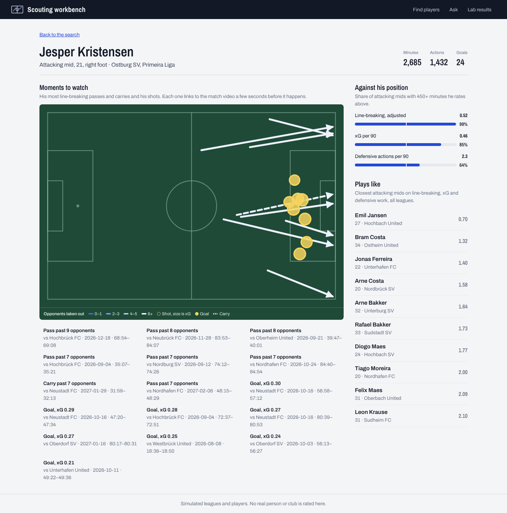
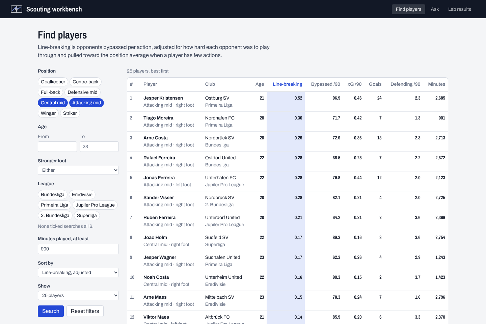
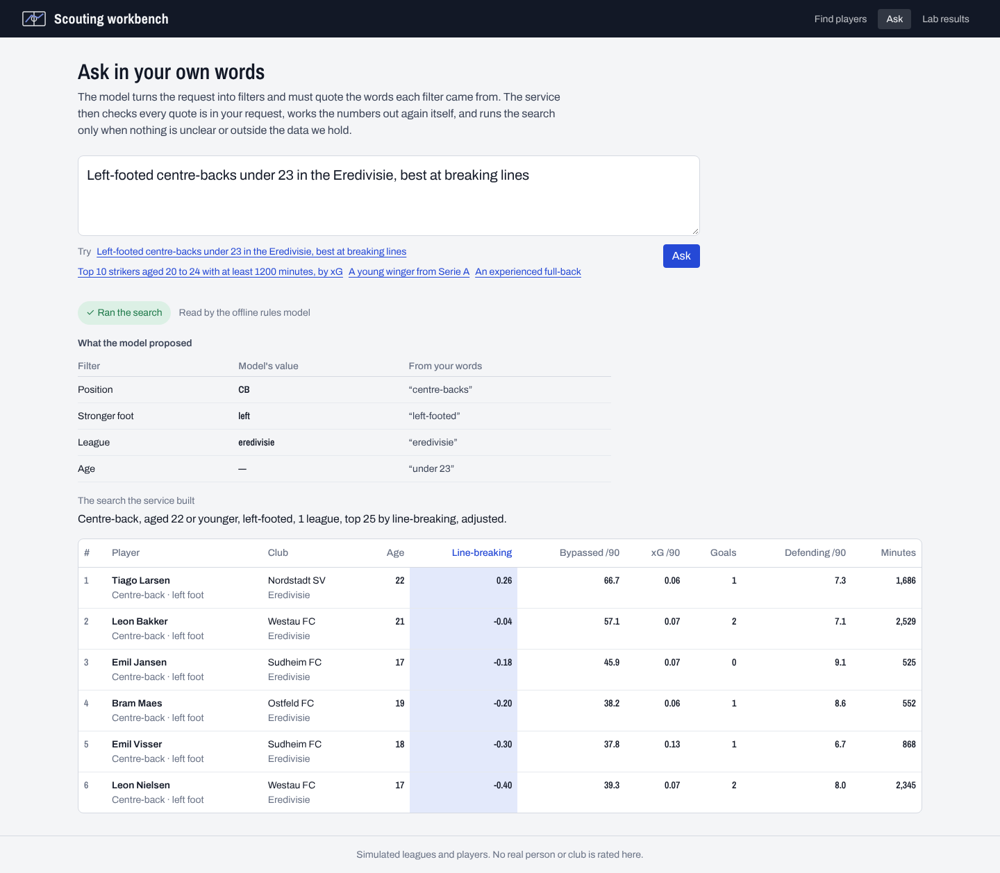

# football-scouting-workbench

A scouting workbench for clubs that buy players from leagues they cannot watch every week. An Angular console on a
Spring Boot (Java 21) service and PostgreSQL: search players by position, age, foot, league and minutes, rank them by an
opponent-adjusted line-breaking rating, open a player to see where his best passes, carries and shots happened with a
link to each moment in the match video, find players who play like him, and ask for players in plain English.

The data is a simulated season of six European leagues with about two million events, built so that every player's
true ability is known. That is what lets the repository measure whether a rating finds the right players, instead of
asserting it.



## Results

Generated by `./gradlew :lab:run --args=report` from `reports/`; CI fails if this section disagrees with the code.

<!-- results:start -->
Dev seeds 501, 502, 503: each a simulated season of 6 leagues, 2,112 players and 1,583 matches. Every design reads the same season.

| | | |
|---|---|---|
| **48% → 78%**<br>Best young progressors in the top 20<br><sub>per-90 sort vs opponent-adjusted, shrunk per-action rating</sub> | **0.57 → 0.96**<br>Rank correlation with true ability<br><sub>season totals vs the platform's rating</sub> | **0% → 10%**<br>Bundesliga players in the top 20<br><sub>truly: 13%; per 90 overrates weaker leagues</sub> |
| **44% → 0%**<br>Assistant answers that show the wrong players<br><sub>model's filters run as they are vs checked against the request</sub> | **56% → 90%**<br>Requests answered correctly<br><sub>asks back on 10% it could have run</sub> | **240 ms → 0.3 ms**<br>Search p95 on PostgreSQL<br><sub>1,948,023 events; measured on a 2-core development VM</sub> |

### Finding young progressors

| Ranking | Best 20 found | Rank correlation | Bundesliga share of top 20 | Players rated |
|---|--:|--:|--:|--:|
| Season totals (the default sort) | 33% | 0.57 | 2% | 100% |
| Per 90, at least 450 minutes | 48% | 0.78 | 0% | 85% |
| Per action, at least 450 minutes | 50% | 0.80 | 0% | 85% |
| Per action, opponent-adjusted, shrunk | 78% | 0.96 | 10% | 100% |
| Platform without opponent adjustment | 52% | 0.80 | 0% | 100% |
| Platform without shrinkage (450 minutes floor) | 75% | 0.97 | 10% | 85% |


### The scouting assistant

| 300 requests per seed | Right | Wrong players shown | Asked back when it could have run |
|---|--:|--:|--:|
| Model's filters run as they are | 56% | 44% | 0% |
| Model proposes, code checks | 90% | 0% | 10% |


### Search on PostgreSQL

8 searches, 25 runs each, on PostgreSQL 16 with 1,948,023 events (measured on a 2-core development VM; CI does not compare timings).

| Search | p50 | p95 | Plan |
|---|--:|--:|---|
| Aggregate the event table per search | 188.4 ms | 240.0 ms | Limit > Sort > Merge Join > Hash Join > Seq Scan on player > HashAggregate |
| Filter players, then indexed event lookups (V2 indexes) | 3.9 ms | 24.1 ms | Limit > Sort > Nested Loop > Seq Scan on player > Index Only Scan using team_pkey on team > Aggregate |
| Read the player_ratings read model | 0.1 ms | 0.3 ms | Limit > Sort > Bitmap Heap Scan on player_ratings |


### Gates

| Gate | Dev seeds | Held-out seeds |
|---|---|---|
| At least 60% of the 20 best young progressors in the top 20 | pass (0.7833 >= 0.6) | pass (0.825 >= 0.6) |
| Finds at least 1.5x as many of them as a per-90 sort | pass (0.7833 >= 0.725) | pass (0.825 >= 0.75) |
| Rank correlation with true ability at least 0.9 | pass (0.9597 >= 0.9) | pass (0.9654 >= 0.9) |
| Rates every young outfield player who played 270+ minutes | pass (1.0 >= 1.0) | pass (1.0 >= 1.0) |
| The assistant never shows a wrong result | pass (0.0 <= 0.0) | pass (0.0 <= 0.0) |
| The assistant answers at least 80% of requests correctly | pass (0.9011 >= 0.8) | pass (0.9167 >= 0.8) |
| It asks back on at most 20% of requests | pass (0.0989 <= 0.2) | pass (0.0833 <= 0.2) |

Held-out seeds 9501, 9502 ran once, after the gates were frozen; see `reports/heldout.lock`.

| Ranking | Best 20 found | Rank correlation | Bundesliga share of top 20 | Players rated |
|---|--:|--:|--:|--:|
| Season totals (the default sort) | 40% | 0.54 | 3% | 100% |
| Per 90, at least 450 minutes | 50% | 0.78 | 0% | 85% |
| Per action, at least 450 minutes | 55% | 0.83 | 3% | 85% |
| Per action, opponent-adjusted, shrunk | 83% | 0.97 | 8% | 100% |
| Platform without opponent adjustment | 60% | 0.82 | 3% | 100% |
| Platform without shrinkage (450 minutes floor) | 80% | 0.97 | 8% | 85% |
<!-- results:end -->

## What a scout can do

| Page | What it does |
|---|---|
| **Find players** | Filters on position, age, stronger foot, league and minutes; sort by any rating. The sorted column is marked. |
| **Player** | Minutes, actions and goals; where he stands against his position (share of players with 450+ minutes he rates above); his most line-breaking passes and carries and his shots drawn on the pitch, each linking to the video a few seconds before it happens; the ten closest players in his position across all leagues. |
| **Ask** | Type a request. The model proposes filters and quotes the words each came from; the service checks the quotes, works the numbers out itself and either runs the search, asks one question back, or says the request is outside the data. |
| **Lab results** | The numbers above, read from the generated `web/public/data/results.json`. |

| Find players | Ask |
|---|---|
|  |  |

Every data view has a loading, an error and an empty state; a test checks each page has all three. Screenshots of
every page, light and dark, are in [`docs/screenshots`](docs/screenshots).

## How it works

```
 world (simulated leagues; truth stays here)          lab (designs, seeds, gates, perf)
        │ observed matches, appearances, events              │ reads world + core, writes reports/
        ▼                                                     ▼
 PostgreSQL ── V1 schema: league, team, player, match, appearance, event, team_defence, player_ratings
        │       V2 indexes: event (player_id, type) INCLUDE …, event (match_id, second), appearance (player_id)
        ▼
 service (Spring Boot 4, JdbcClient, Flyway) ── core (ratings, query, SQL compiler, similarity, assistant checks)
        │  /api/search  /api/players/{id}  /similar  /moments  /assistant  /admin/refresh
        ▼
 web (Angular 22, standalone components, signals, httpResource) — served by the same jar
```

**The rating.** Line-breaking is opponents bypassed per action, not per 90 and not a season total. A team's
defensive strength is fitted from every appearance with alternating ridge least squares
(`log(bypassed per action) = attack(team) − defence(opponent)`), and each action is credited against the opponent it
was made against. Players with few actions are pulled toward their position's average (empirical Bayes, worth 80
actions of prior). The score is `log(rate / position prior)`, so 0 is an average player for the position. All of it is
in `core/Ratings.java` and `core/OpponentModel.java`; the constants are in `config/platform.json`.

**The read model.** `POST /admin/refresh` recomputes ratings for every player and replaces `player_ratings` in one
transaction. Searches read that table, never the events. The lab measured the alternative (see *Search on
PostgreSQL*): aggregating two million events per search costs about 240 ms at p95, the V2 indexes bring the same
query to about 24 ms, and the read model answers in under a millisecond.

**The query.** A search becomes a `ScoutQuery`, which validates itself against the catalogue of positions, leagues and
limits, then `SqlCompiler` turns it into one parameterized statement. Values never enter the SQL text; the sort column
comes from the `Metric` enum. `Search` runs the same query in memory, and a test on PostgreSQL checks both return the
same players.

**The assistant.** The model reads and code decides. The model (Claude, or the offline `Rules` model when no key is
set) proposes constraints, each with a verbatim quote from the request. Code then:

1. drops any constraint whose quote is not in the request;
2. re-derives ages, minutes and the limit from the quoted words with its own grammar ("under 23" is 22 or younger);
3. resolves positions, feet, leagues and metrics through closed vocabularies (league aliases must match exactly);
4. compares the request with the vocabularies itself and asks back when the model missed a term it should have used;
5. answers *Needs one answer* for vague words (`young`, `experienced`) and *Outside the data we hold* for leagues we
   do not cover (Serie A, Premier League, …). Both lists are in `config/platform.json`.

**Moments.** Each event keeps its match second; a clip starts eight seconds before and ends six after, as a media
fragment (`#t=from,to`) on the match's video URL.

## API

| Method and path | Body or parameters | Answer |
|---|---|---|
| `GET /api/leagues` | | `[{id, name, country}]` |
| `POST /api/search` | `{positions, minAge, maxAge, foot, leagueIds, minMinutes, sortBy, limit}` | player cards, best first; 400 with `{problems}` |
| `GET /api/players/{id}` | | `{player, percentiles}`; 404 |
| `GET /api/players/{id}/similar` | | ten nearest players in the position, with distance |
| `GET /api/players/{id}/moments` | `limit` (1–50) | `[{moment, clip: {from, to, url}}]` |
| `POST /api/assistant` | `{request}` (1–500 characters) | `{status, source, constraints, query, messages, results}` |
| `POST /api/admin/refresh` | header `x-admin-key` | `{rated}`; 401 without the key |

## Run it

Needs Java 21, PostgreSQL 16 and Node 22.

```bash
createuser scout --pwprompt            # password: scout
createdb -O scout scouting
./gradlew build                        # every module and test; the PostgreSQL tests run when SCOUT_TEST_DB_URL is set
(cd web && npm ci && npm run build)    # the console, bundled into the jar by the next step
./gradlew :service:bootJar
./gradlew :lab:run --args="load-db 77" # a season into PostgreSQL (about 40 s, 1.95 million events)
SCOUT_ADMIN_KEY=dev-admin java -jar service/build/libs/football-scouting-workbench.jar
open http://localhost:8091
```

The service rates players on start when `player_ratings` is empty. `ANTHROPIC_API_KEY` switches the assistant to
Claude (model in `config/platform.json`); without it the offline rules model answers. For console work run
`npm start` in `web/`, which proxies `/api` to port 8091.

## The lab

`./gradlew :lab:run --args=…`

| Command | What it does |
|---|---|
| `dev [--check]` | Runs every design on the dev seeds and writes `reports/dev.json`; `--check` fails if the file does not reproduce exactly. |
| `heldout` | Runs the held-out seeds once and writes `reports/heldout.lock`; refuses to run again. |
| `gate` | Prints each gate in `config/lab/gates.json` and fails on a dev miss. |
| `perf` | Loads a season into the `perf_lab` schema and times the three search designs (`reports/perf.json`). |
| `report` | Writes `REPORT.md`, the results section above and `web/public/data/results.json`. |
| `load-db [seed]` | Loads a season into the database the service uses. |

The ranking study's truth is the 20 under-24 outfield players with the highest true progression ability among those
with 270+ minutes. Every design sees the same matches: each random draw in the world is keyed by seed, purpose and
ids, so a design cannot get luckier draws than another. The assistant study runs 300 requests per seed through a
simulated model with set error rates (wrong numbers, invented leagues, dropped terms, unquoted filters) once with its
filters run as proposed and once through the checks.

## Limits

- **Simulated, not real data.** Leagues, teams, players and events come from `world/`. Real event feeds have
  different noise, positions change during a match, and line-breaking is computed from tracking data, not drawn from
  a distribution. The lab shows the method recovers a known truth; it does not show it on a real league.
- **The video is a placeholder.** Clip links point at `video.example`; with a real video host the same `#t=` fragments
  open the moment.
- **The assistant study uses a simulated model.** Its error rates are set in `config/lab/world.json`. The Claude path
  is implemented, and its reply parser is tested on canned replies, but its accuracy is not measured here.
- **One season, no transfers.** A player has one team; ratings do not carry across seasons or adjust for age curves.
- **Latency was measured on a 2-core development VM** with one connection. CI does not compare timings.
- **Back end in Java, not Kotlin.** The service is Java 21; the same design ports to Kotlin unchanged.

## Repository

| Path | What is there |
|---|---|
| `world/` | the simulated leagues; the only place the truth lives |
| `core/` | ratings, opponent model, query, SQL compiler, similarity, assistant checks; no Spring |
| `service/` | Spring Boot 4 REST service, Flyway migrations, JdbcClient repository |
| `lab/` | studies, gates, perf study, reports, database loader |
| `web/` | Angular 22 console (`src/app/features/*`, tokens in `src/styles/_tokens.scss`) |
| `config/` | `platform.json` (what the service reads), `lab/` (world, seeds, gates) |
| `docs/adr/` | decisions and why |

AGENTS.md lists the invariants and the held-out rule; SKILLS.md the repeatable tasks.
